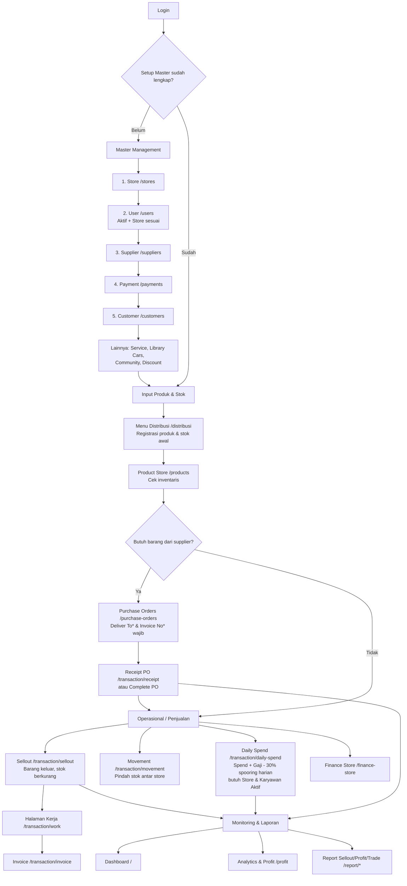
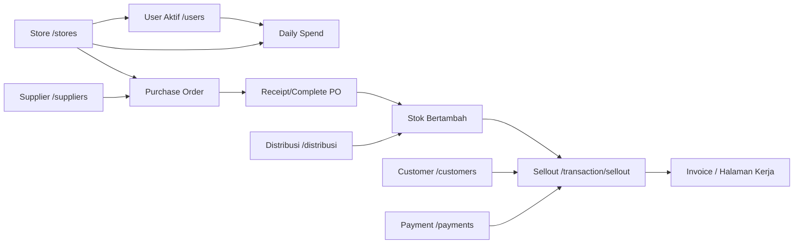

# Flow Penggunaan WheelsKopi ERP

Dokumen ini menjelaskan **urutan input data**, **alur proses utama**, dan **fungsi tiap navigasi** agar alur kerja tidak membingungkan.

> Catatan: data disimpan di browser (`localStorage`) per perangkat/browser. Login & hak akses menu mengikuti **Role/Permission** user.

---

## 1. Urutan Input (Siapa/apa duluan)

### A. Setup Awal — Master Management (WAJIB dulu)
Input ini jadi sumber pilihan (dropdown) di modul lain.

| Urutan | Navigasi | Path | Fungsi | Kenapa duluan / dipakai di mana |
|---|---|---|---|---|
| 1 | **Store** | `/stores` | Kelola daftar toko/cabang (nama, kode, status, dll.) | Sumber pilihan **Store/Deliver To** di PO, Sellout, Daily Spend, Finance, Movement, dll. *Nama store harus konsisten.* |
| 2 | **User** | `/users` | Kelola akun & karyawan (role, status, store, gaji pokok, periode gaji) | Login/akses. **List Karyawan** di Daily Spend hanya muncul jika user **Aktif** dan **Store-nya sama** dengan store yang dipilih. |
| 3 | **Supplier** | `/suppliers` | Kelola supplier | Wajib/dipakai saat buat **Purchase Order**. |
| 4 | **Payment** | `/payments` | Kelola metode pembayaran | Dipakai di transaksi (mis. Sellout/payment method). |
| 5 | **Customer** | `/customers` | Kelola pelanggan | Dipakai saat input **Sellout**. |
| 6 | **Service** | `/services` | Kelola layanan/jasa | Referensi layanan operasional. |
| 7 | **Library Cars** | `/library-cars` | Data referensi mobil (merk/tipe/spek) | Referensi kendaraan. |
| 8 | **Community** | `/communities` | Kelola komunitas | Referensi komunitas/pelanggan komunitas. |
| 9 | **Voucher & Discount** | `/discounts` | Kelola diskon/voucher | Referensi promo/diskon. |
| 10 | **Product Store** | `/products` | Lihat inventaris produk & stok | Hasil/daftar produk yang sudah diregistrasi (stok, harga, status). |

> **Masalah umum:** *List Karyawan di Daily Spend kosong* → pastikan **Store** sudah ada, lalu di **User**: `Status = Aktif` dan `Store` sama persis dengan store yang dipilih di form Daily Spend.

### B. Input Produk & Stok
| Urutan | Navigasi | Path | Fungsi |
|---|---|---|---|
| 1 | **Menu Distribusi** | `/distribusi` | Registrasi produk baru (Ban/Others), spesifikasi, gambar, stok awal, harga. Bisa tambah merek/type/ring manual. Produk masuk ke inventaris. |
| 2 | **Product Store** | `/products` | Monitoring/edit/hapus & lihat detail produk/stok hasil registrasi. |

### C. Pengadaan Barang (Stok Masuk via PO)
| Urutan | Navigasi | Path | Fungsi |
|---|---|---|---|
| 1 | **Purchase Orders** | `/purchase-orders` | Buat PO ke supplier (Deliver To & Invoice Number wajib, Kode Barang auto/manual, Additional Discount auto/manual). Status Draft/Completed. |
| 2 | **Receipt PO** | `/transaction/receipt` | Buat tanda terima untuk PO (pilih nomor PO) → menandai penerimaan/completed sesuai alur penerimaan. |
| 3 | *(Opsi)* Complete PO | `/purchase-orders` (aksi Complete) | PO Completed menambah stok & mencatat ke finance/ledger (sesuai integrasi sistem). |

### D. Transaksi Penjualan & Operasional Harian
| Urutan | Navigasi | Path | Fungsi | Ketergantungan |
|---|---|---|---|---|
| 1 | **Sellout** | `/transaction/sellout` | Input barang keluar/penjualan (customer, mobil/plat, store, produk, qty, metode bayar). Bukan invoice. | Butuh **Produk/Stok**, **Customer**, **Store**, **Payment**. Mengurangi stok. |
| 2 | **Halaman Kerja** | `/transaction/work` | Proses kerja terkait sellout/mekanik (workflow kerja). | Terkait data sellout/mekanik. |
| 3 | **Invoice** | `/transaction/invoice` | Pembuatan/dokumen invoice dari sellout yang disetujui. | Dari data sellout. |
| 4 | **Movement** | `/transaction/movement` | Perpindahan barang antar store. | Butuh store asal/tujuan & produk. |
| 5 | **Daily Spend** | `/transaction/daily-spend` | Input pengeluaran harian (spend, spooring, gaji karyawan). Total harian = spend + gaji - 30% spooring hari itu; ringkasan akumulasi potongan spooring 30% bulanan per store. | Butuh **Store** & **User Aktif** di store tsb (List Karyawan). Tercatat ke finance. |
| 6 | **Finance Store** | `/finance-store` | Rekap/kelola keuangan toko (ledger: penjualan, pembelian, spend, dll.). | Dari transaksi terkait. |
| 7 | **Sales Orders / Sellout Global / Daily Spend Global** | `/transaction/sales-orders`, `/transaction/sellout-global`, `/transaction/daily-spend-global` | Monitoring/revisi data global penjualan & pengeluaran. | Dari data transaksi yang sudah ada. |

### E. Monitoring & Laporan
| Navigasi | Path | Fungsi |
|---|---|---|
| **Dashboard** | `/` | Ringkasan KPI, penjualan, stok, transaksi, insight (bisa filter tanggal). |
| **Analytics & Profit** | `/profit` | Analitik & profit. |
| **Report Sellout** | `/report/sellout` | Laporan sellout. |
| **Report Profit** | `/report/profit` | Laporan profit. |
| **Trade Sellout** | `/report/trade-sellout` | Laporan trade sellout. |

### F. Pengaturan (khusus Administrator)
| Navigasi | Path | Fungsi |
|---|---|---|
| **Utility** | `/settings/utility` | Pengaturan/utilitas sistem (akses admin). |

---

## 2. Flow Diagram (Urutan Kerja)

---

## 3. Referensi Navigasi (Sidebar)

| Grup | Menu | Path | Fungsi singkat | Akses (module) |
|---|---|---|---|---|
| Utama | Dashboard | `/` | Ringkasan operasional & KPI | `dashboard` |
| Distribusi | Menu Distribusi | `/distribusi` | Registrasi/input produk & data distribusi | `distribusi` |
| Analitik | Analytics & Profit | `/profit` | Analitik & profit | `profit` |
| Master Management | Product Store | `/products` | Inventaris produk & stok | `product` |
| Master Management | Supplier | `/suppliers` | Master supplier | `supplier` |
| Master Management | Store | `/stores` | Master toko/cabang | `store` |
| Master Management | User | `/users` | Master user/karyawan & akun | `user` |
| Master Management | Payment | `/payments` | Metode pembayaran | `payment` |
| Master Management | Service | `/services` | Master layanan/jasa | `service` |
| Master Management | Library Cars | `/library-cars` | Referensi data mobil | `library` |
| Master Management | Community | `/communities` | Master komunitas | `community` |
| Master Management | Customer | `/customers` | Master pelanggan | `customer` |
| Master Management | Voucher & Discount | `/discounts` | Diskon & voucher | `discount` |
| Transaction | Purchase Orders | `/purchase-orders` | PO ke supplier (stok masuk) | `purchase-order` |
| Transaction | Receipt PO | `/transaction/receipt` | Tanda terima PO | `receipt` |
| Transaction | Sellout | `/transaction/sellout` | Penjualan/barang keluar | `sellout` |
| Transaction | Halaman Kerja | `/transaction/work` | Workflow kerja/mekanik | `sellout` |
| Transaction | Invoice | `/transaction/invoice` | Dokumen invoice | `invoice` |
| Transaction | Movement | `/transaction/movement` | Mutasi stok antar store | `movement` |
| Transaction | Daily Spend | `/transaction/daily-spend` | Pengeluaran harian, spooring & gaji | `daily-spend` |
| Transaction | Finance Store | `/finance-store` | Keuangan/ledger toko | `finance-store` |
| Transaction | Sales Orders | `/transaction/sales-orders` | Data sales order | `sales-order` |
| Transaction | Sellout Global | `/transaction/sellout-global` | Monitoring/revisi sellout global | `sellout-global` |
| Transaction | Daily Spend Global | `/transaction/daily-spend-global` | Monitoring/revisi daily spend global | `daily-spend-global` |
| Report | Report Sellout | `/report/sellout` | Laporan sellout | `report` |
| Report | Report Profit | `/report/profit` | Laporan profit | `report` |
| Report | Trade Sellout | `/report/trade-sellout` | Laporan trade sellout | `trade-sellout` |
| Utility | Utility | `/settings/utility` | Pengaturan sistem (admin) | `utility` (Administrator) |

---

## 4. Catatan Penting
- **Store & User harus match:** dropdown Store diambil dari Master Store; karyawan Daily Spend = user `Aktif` dengan field `store` yang **sama persis**.
- **Stok bertambah** dari registrasi Distribusi atau PO yang completed/diterima (sesuai alur). **Stok berkurang** saat Sellout/Movement keluar.
- **Daily Spend:** total harian `= spend + gaji - 30% spooring hari itu`. Potongan spooring dihitung per transaksi dan **diakumulasikan per bulan per store** (contoh: total spooring 300 × 100.000 = 30.000.000 → potongan 30% = 9.000.000).
- **Akses menu** tergantung permission role; beberapa halaman khusus Administrator (mis. Utility).
